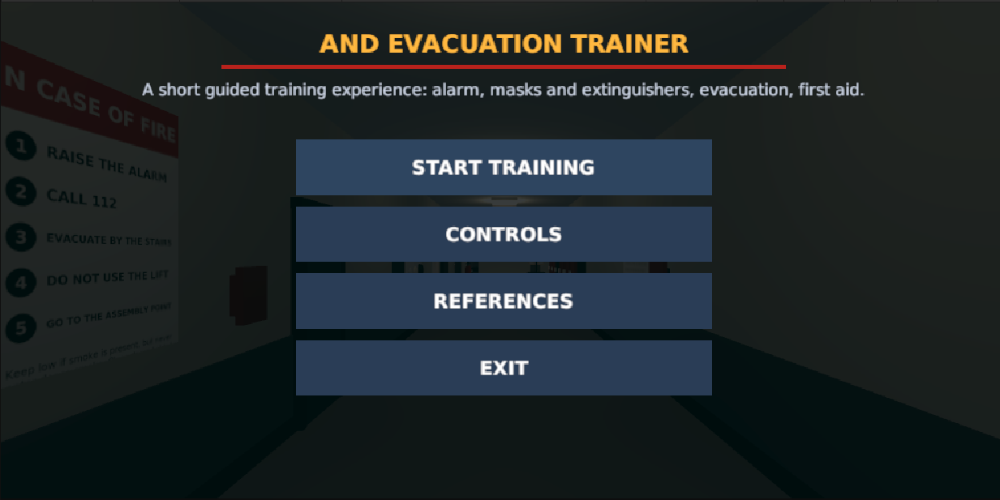
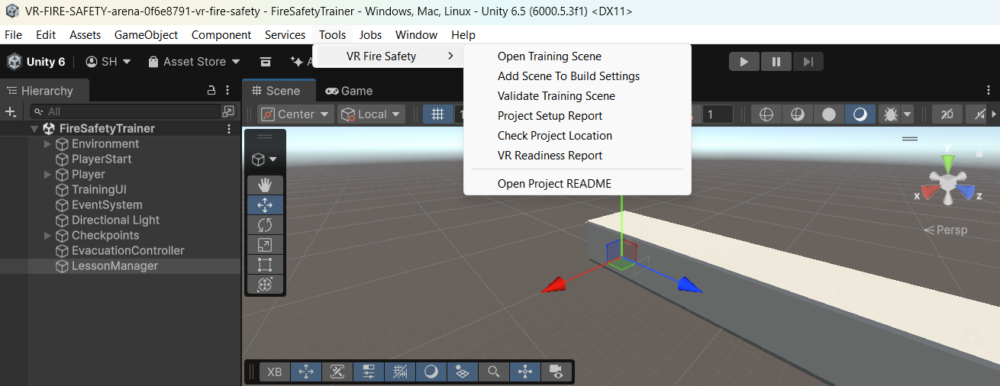
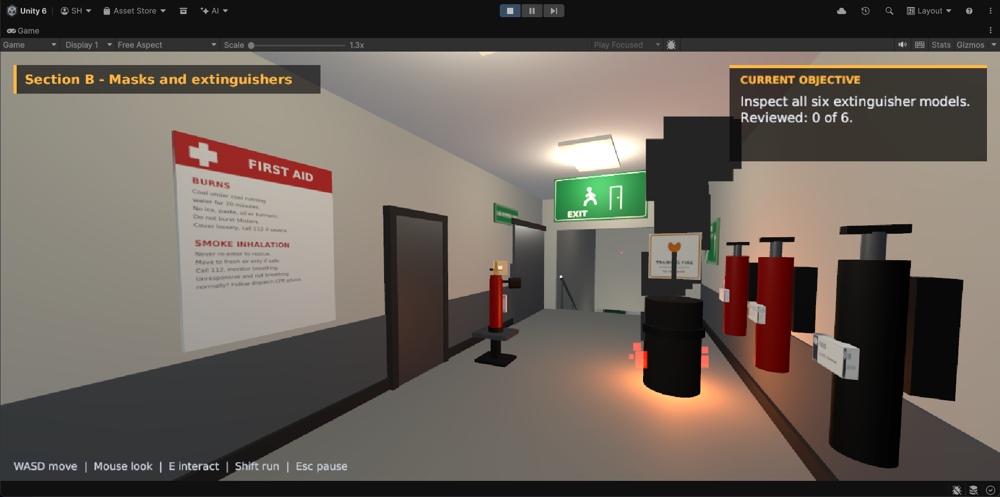
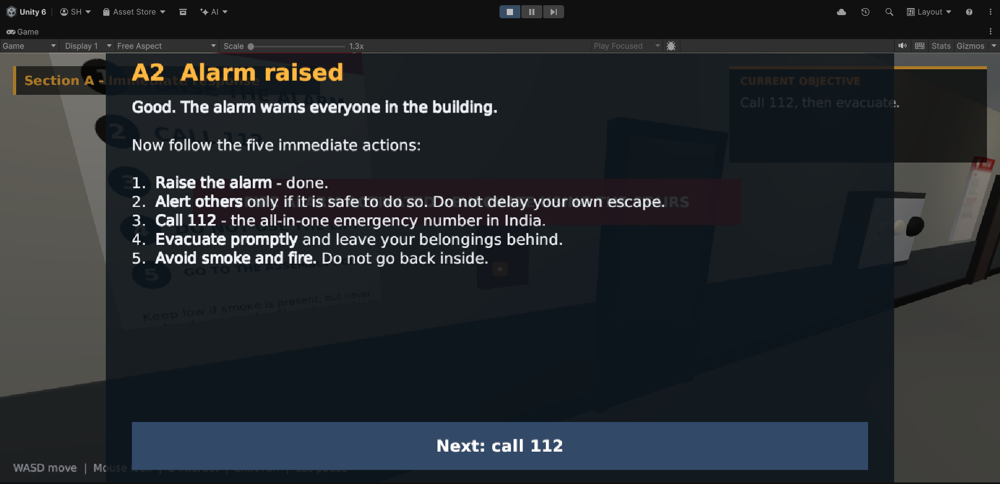
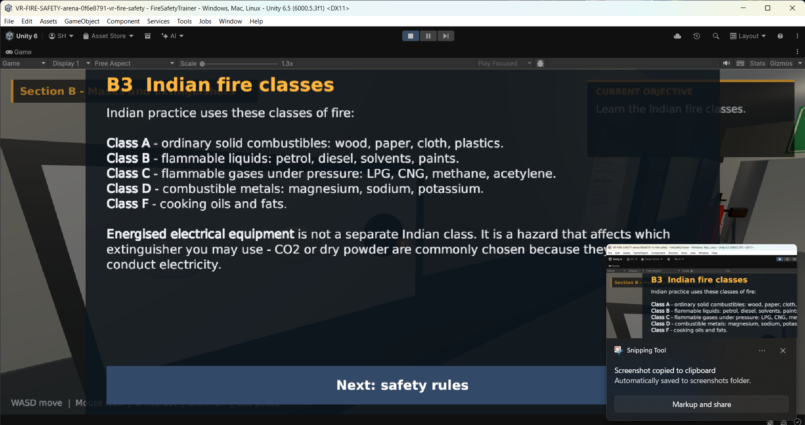
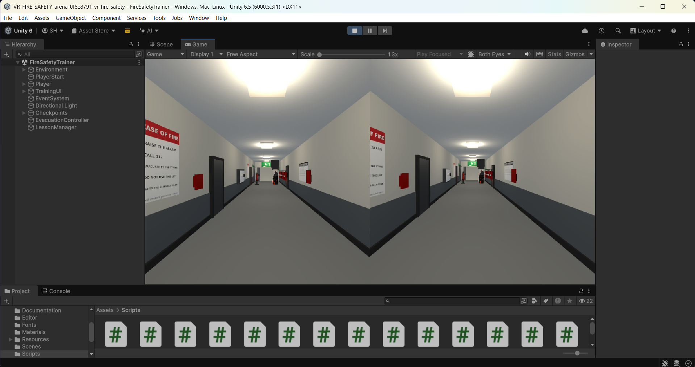
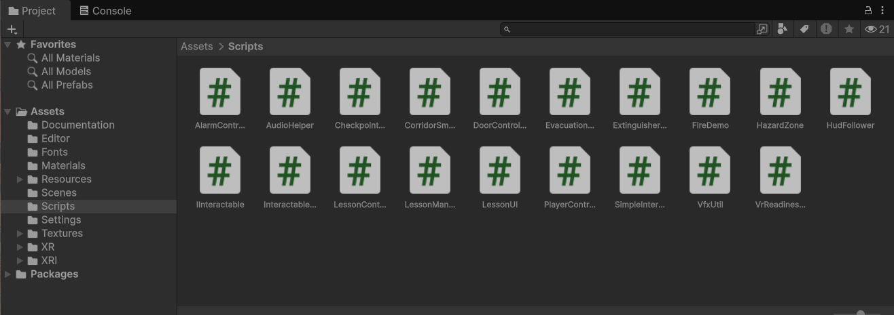
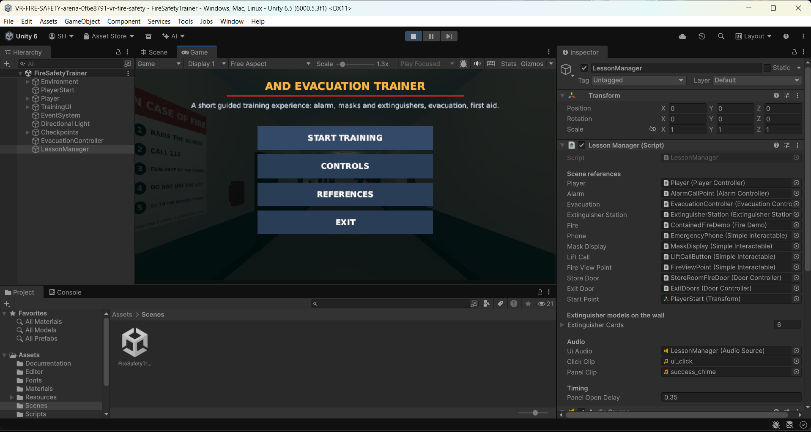
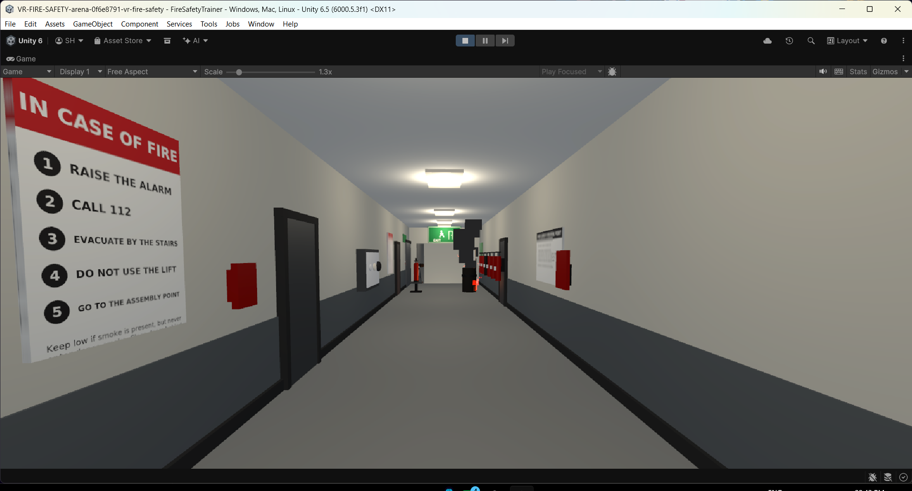
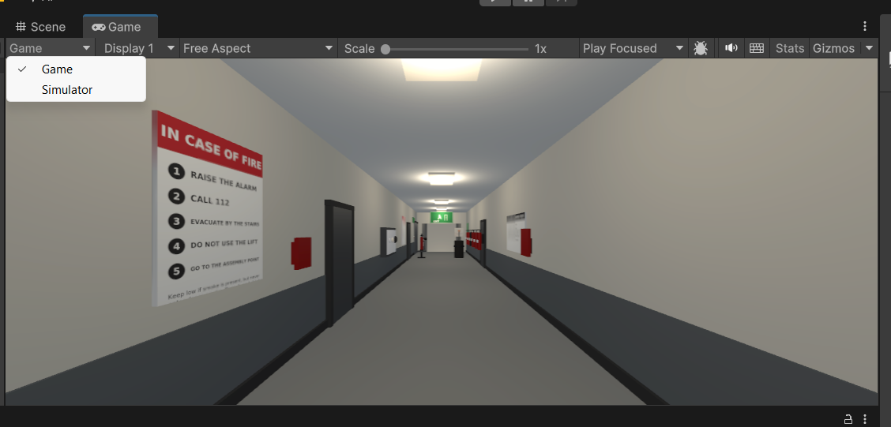

# VR Fire Safety and Evacuation Trainer

**Project report**

This report describes the project as it stands now. Anything about earlier versions, things
that broke and things that were thrown away is kept in the last section, so the main part of the
document only describes what you get if you open the project today.

All the pictures are real screenshots taken from Unity 6000.5.3f1 while the project was running.

---

## 1. What this project is

It is a short, guided fire-safety and evacuation lesson that you walk through in first person.
You start in a corridor in a building, you raise the alarm, you look at masks and extinguishers,
you go down one flight of stairs past a smoke hazard, and you finish outside at the assembly
point with two first-aid panels.

It is a teaching tool, not a game. There is no score, no timer, no enemy, no character to talk
to, and nothing to collect. The route is one fixed line: corridor → stairs → corridor → outside.
You cannot get lost and you cannot take a wrong turn, because there is nowhere else to go.

Someone using it needs nothing except the mouse and keyboard. A VR headset is optional.

| | |
| --- | --- |
| Made with | Unity 6000.5.3f1, Universal Render Pipeline (URP) |
| Size | One scene, one floor, 4 sections |
| Runs without a headset | Yes — normal Play mode in the Editor |
| Set up for a headset | Yes — OpenXR, Android build set to ARM64, Android 10 (API 29) minimum (not yet worn in a real headset, see section 11) |
| Scripts | 21 C# files in `Assets/Scripts` and `Assets/Editor` |
| Interactable objects | 14 (call point, phone, display, six extinguisher cards, door, exit, lift, practice station, and so on) |
| Time to finish | About ten minutes at a walking pace |
| Content sources | 10, all listed in section 10 of this report and inside the game's REFERENCES screen |

---

## 2. Opening and running it

1. Open the `VR-FIRE-SAFETY` folder with Unity **6000.5.3f1**. The first open takes a while
   because Unity imports the packages and shaders.
2. Open the scene `Assets/Scenes/FireSafetyTrainer.unity`. If it is not already open,
   `Tools ▸ VR Fire Safety ▸ Open Training Scene` opens it for you.
3. Press **Play**. The main menu appears.
4. Click **START TRAINING**, or just press Play and use the on-screen buttons with the mouse.

The menu offers four things: start the lesson, read the controls, read the list of sources, or
quit.



*Figure 1 — Main menu. Start, controls, references, exit, and the building dimmed behind it. The
very top line of the title is clipped in this particular capture, not in the game.*

If you are checking the project rather than using it, the `Tools ▸ VR Fire Safety` menu has a few
helpers. `Validate Training Scene` prints a checklist to the Console. `Project Setup Report` and
`VR Readiness Report` write Markdown files into `docs/`.



*Figure 2 — The project's own tools, under the Tools menu.*

---

## 3. The building

Everything happens on one floor. There are four parts, in this order.

1. **First corridor.** This is where you start. It holds the "IN CASE OF FIRE" notice, the red
   alarm call point, the red 112 phone, the mask display, six extinguishers on the wall, the
   practice stand and one small fire in a metal bin. It is about 23 metres long and 4 metres wide,
   with a 3.2 metre ceiling.
2. **Stair lobby and one flight of stairs.** There are lift doors with a call button and a sign
   telling you not to use the lift. One flight goes down 3.5 metres, with a handrail on each side.
3. **Second corridor.** Exit signs lead you along it. Halfway down there is a fire door holding
   back a wall of dense smoke, and a warning sign next to it.
4. **Outside, at the assembly point.** Green assembly signage, a marked square on the ground, a
   shelter and a fence. The two first-aid panels are here (Section D).

Every part of the route is closed in — floor, walls, ceiling — so you never see a hole in the
world or a sign floating in the air.



*Figure 3 — The middle of the first corridor, in Section B. The first-aid poster on the left, the
six extinguishers on the right, and the one contained fire in the bin in the middle of the floor.
The section name sits top left and the current objective sits top right.*

---

## 4. What happens in each section

The lesson is a straight line of small steps. Each step shows one panel and then unlocks exactly
one thing to do. You always know where you are because the current objective is printed in the
top-right corner.

| Section | What you do | What it teaches |
| --- | --- | --- |
| **A — Immediate response** | Read the opening panel, walk to the red call point and press `E`, then use the red 112 phone | Raise the alarm first, warn others only if it is safe, call 112, leave your belongings, do not go back in |
| **B — Masks and extinguishers** | Look at the mask display, read all six extinguisher cards, answer one safe-response question, then watch the PASS demonstration on the single contained fire | What each kind of mask can and cannot do, the Indian fire classes, which extinguisher suits which fire, and when to give up on fighting the fire and leave |
| **C — Evacuation** | Follow the exit signs, try the lift and be told why not, go down the stairs, stop at the dense smoke, close the fire door, get outside and reach the assembly point | Why lifts are avoided, how smoke actually harms people, that staying low is not a guarantee, that you turn back rather than walk into dense smoke, and how closing a door slows a fire |
| **D — First aid** | Read the two panels at the assembly point | Burns (20 minutes of cool running water, what not to put on it, when to get urgent help) and smoke inhalation (never go back inside, call 112, watch the breathing) |

There is exactly **one** fire in the whole project: a small fire in a metal bin, in the first
corridor, in a space with a clear way out behind you. That is deliberate. The lesson is about
recognising when a fire is small enough to tackle and when it is time to leave, so a single small
fire that you can actually put out is more useful than a room full of flames.



*Figure 4 — Section A after raising the alarm. The alarm panel lists the five immediate actions.
This capture was taken before the fix described in section 13.7, so the section name is still
showing through the panel title.*

---

## 5. Controls

**With mouse and keyboard**

| Input | What it does |
| --- | --- |
| `W` `A` `S` `D` | Walk |
| Mouse | Look around |
| `Shift` | Walk faster |
| `E` | Use the thing under the centre of the screen |
| Left click | Press a button on screen |
| `Esc` | Pause and unpause |

While a panel is open the mouse cursor is let go, so you just click the button you want. Nothing
else in the game is listening for input at that moment, so you cannot accidentally walk away
while a lesson panel is up.

**In a headset**

| Input | What it does |
| --- | --- |
| Left stick | Walk |
| Right stick | Turn in 30° steps |
| Trigger | Use objects and press buttons |
| Head | Look around |

Turning in fixed 30° steps instead of smoothly is a comfort decision — smooth turning in a
headset makes some people feel sick.

---

## 6. What is on screen, and why it stays on screen

Three things are always visible while you are walking around:

* the **section name**, top left, so you know which part of the lesson you are in;
* the **current objective**, top right, which is the one thing you are meant to do next;
* the **controls hint** along the bottom, in case you have forgotten which key does what.

Panels take over the middle of the screen. While one is open, the three items above step out of
the way so the panel's title is not printed on top of the section name.



*Figure 5 — A teaching panel from Section B, listing the Indian fire classes: A (solids), B
(flammable liquids), C (flammable gases), D (combustible metals) and F (cooking oils and fats).
Also captured before the fix in section 13.7, so the objective box shows through the panel. The
small window in the bottom-right corner is the Windows screenshot tool, not part of the game.*

Two rules shaped this part of the project, and they were both learned the hard way (see the last
section):

* **A panel is never hidden behind anything.** In a headset the interface has to live in the 3D
  world, which means a panel placed in front of you can end up on the far side of a wall you are
  standing next to — you press `E`, nothing appears to happen, and the panel is actually inside
  the wall. The interface now casts a short ray forward and pulls itself in front of whatever is
  in the way, then walks back out again.
* **A panel is never bigger than the screen.** The layout is designed at 1600 × 900 and then
  scaled to whatever field of view and window shape it is being drawn into, so nothing is cut off
  in a narrow window or a headset.

---

## 7. The things you look at

**The six extinguishers.** Six full-size extinguishers are mounted on the wall in the first
corridor, each with a wall card next to it. You review them one at a time. They are water, foam,
ABC dry powder, CO₂, wet chemical, and a special Class D powder. Each card says what the unit is
for, whether it suits the fire in this building, and — importantly — what you must never use it
on.

**The Indian fire classes.** The game uses the Indian classification, not the American one:

| Class | What burns |
| --- | --- |
| A | Ordinary solids — wood, paper, cloth, plastics |
| B | Flammable liquids — petrol, diesel, solvents, paints |
| C | Flammable gases under pressure — LPG, CNG, methane, acetylene |
| D | Combustible metals — magnesium, sodium, potassium |
| F | Cooking oils and fats |

Energised electrical equipment is **not** a class of its own in Indian practice. It is a hazard
that changes which extinguisher you may pick, which is why the ABC powder card and the CO₂ card
both talk about it.

**The masks.** Four kinds are shown: a cloth or surgical mask, an N95 respirator, an escape hood,
and a self-contained breathing apparatus. The lesson is blunt about them: a cloth mask does
nothing against smoke, an N95 is a dust mask, an escape hood buys you a short walk out and
nothing more, and only SCBA lets you work in smoke — and you will not have one. There is no
moment in this project where you are told to put on a mask and walk into smoke.

**The PASS demonstration.** PASS stands for Pull, Aim, Squeeze, Sweep. Rather than a list of
words with a Next button, the practice unit actually performs it: the safety pin leaves the
valve, the horn turns to the base of the fire, the lever is pressed, and the powder jet sweeps
across until the fire is out. A caption counts you through the four steps as they happen.

---

## 8. How it looks in a headset, and the stereo view

The project is set up for OpenXR. In `Edit ▸ Project Settings ▸ XR Plug-in Management` the PC
tab has OpenXR enabled, and `Project Settings ▸ OpenXR` uses **Single Pass Instanced** rendering
(a single pass that draws both eyes at once, which is what you want on a Quest) with an Oculus
Touch controller profile enabled.



*Figure 6 — The Game view in Both Eyes mode. Two eye images side by side, drawn in the Editor
without a headset, using Unity's Mock HMD runtime. No HUD is visible here because this run hit
the bug described in section 13.6.*

To see that without owning a headset, install `com.unity.xr.mock-hmd`, tick **Mock HMD** in XR
Plug-in Management, and press Play. The Game view's eye selector then offers *Both Eyes*, and the
project switches to it by itself when an XR session starts — you do not have to hunt for it.

**What this proves and what it does not.** It proves the stereo path works and that the interface
draws correctly in both eyes. It does not prove head tracking or controller input, because the
Mock HMD runtime deliberately provides neither. This project has not been worn in a physical
headset.

When a headset *is* connected, the interface changes from a flat overlay into a panel that sits
in the world in front of you, and it follows your head. That switch happens automatically, and it
also happens if a headset is connected or disconnected while the game is running.

---

## 9. What is in the folders



*Figure 7 — The Scripts folder. One file per job: the lesson brain, the interface, the player,
the alarm, the fire, the smoke, the doors, the checkpoints.*

```
Assets/
  Scenes/FireSafetyTrainer.unity    the whole project, one scene
  Scripts/                          19 files — the lesson, the interface, the player, the props
  Editor/                           the Tools ▸ VR Fire Safety helpers and the validators
  Materials/   Fonts/   Textures/   generated by scripts, see below
  Settings/                         the URP asset and its renderer
  XR/   XRI/                        the folders OpenXR and the interaction toolkit expect
docs/
  Project-Report.md                 this document
  VR-Readiness-Evidence.md          how to show the headset path working
  screenshots/                      every picture in this report
tools/                              Python scripts that generate and check the project
```

`LessonManager.cs` is the brain. It is one long list of steps: show this panel, unlock this one
object, wait. Every object in the scene that you can interact with simply reports "I was used"
and the manager decides whether that was the right thing at the right time. All of the teaching
text lives in `LessonContent.cs`, separate from the logic, so the wording can be changed without
touching how the lesson runs.

The scene, the materials, the signs and the sound effects were all **generated by Python scripts**
in `tools/` rather than made by hand. That means the project can be rebuilt from scratch and the
result reviewed line by line, and it means there is no imported artwork to go missing.



*Figure 8 — The Editor with the scene open. The Hierarchy on the left, the Game view in the
middle, and the Inspector on the right showing `LessonManager` and the twelve scene objects it
is wired to.*

---

## 10. Where the information came from

Nothing in the lesson was invented. Every claim about burns, smoke, masks, extinguishers or
emergency numbers is checked against one of these, and the same list is inside the game behind
the REFERENCES button.

| Source | What it was used for |
| --- | --- |
| WHO — Burns fact sheet | Burn first aid basics |
| NHS (UK) — Burns and scalds: treatment | 20 minutes of cool running water, what not to apply |
| American Red Cross — Burns | When a burn needs urgent care |
| OSHA — Respiratory protection guidance | What respirators do and do not do |
| OSHA — Smoke escape hoods (interpretation letter) | Escape hood limits |
| 3M — Wildfire respirator FAQ | N95 limits, manufacturer's own wording |
| RDSO, Indian Railways — Classification of fires | The Indian fire classes |
| National Institute of Fire Safety, India — IS 15683 / IS 2190 | Extinguisher types and the PASS technique |
| 112 India (Ministry of Home Affairs) | The emergency number, and that 112 covers fire, police and ambulance |
| American Heart Association — CPR and ECC guidelines | What to do when someone is not breathing normally |

Two content rules follow from those sources and are followed everywhere in the project:

* **112** is the number taught, not 101 or 100 — it is the single all-in-one emergency number in
  India.
* The escape advice never promises safety. Staying low helps, closing doors helps, but the only
  dependable action is to get out and stay out.

---

## 11. How much of this was actually checked

This matters more than the rest of the report, so it is written plainly.

**Checked, and it passes:**

* All four automated checkers run green in one command (`python3 tools/check_all.py`): the scene's
  1,169 object references all resolve, the lesson flow has no dead ends, the project settings match
  Unity 6.5 and URP, and no script reaches into another script's private parts.
* The project **opens and runs in Unity 6000.5.3f1**. That is no longer a claim — the screenshots
  in this report were taken from it, and they show the Editor, the menu, the teaching panels, the
  corridor at run time and a stereo Game view.

**Checked by hand, in the Editor:**

* The main menu, the alarm panel, the fire-classes panel, the extinguisher wall, the contained
  fire and the Both Eyes view all appear and behave as described above.

**Not checked:**

* **A real headset.** The stereo path is proven with Unity's Mock HMD, which provides no head
  tracking and no controllers. Comfort, scale and readability in a real headset are still
  unknown.
* **An Android build on a Quest.** The build settings are configured (ARM64, API 29,
  `com.vrfiresafety.trainer`) but no build was made and no device was used.
* **The far end of the route.** The stair lobby, the smoke hazard, the assembly point and the
  first-aid panels are built and are handled by the lesson logic, but they were not photographed
  for this report.

If you are marking this project, those three bullets are the honest gap.

---

## 12. Things that are still rough

* The far end of the route has no screenshots yet.
* The lighting is simple and even — it is there to make the corridor readable, not to look
  realistic.
* The people are not modelled. You are a first-person camera, and there is nobody else in the
  building, which keeps the project small but also means "warn others" is explained in text
  rather than shown.
* The audio is a handful of generated clicks and chimes, not recorded sound.
* There is no save. Closing the game ends the run; that is fine for an eight-minute lesson.

---

## 13. Previous versions and problems

Everything in this section is history. It is here because it explains why the project is shaped
the way it is, not because any of it is still true.

### 13.1 Version 0 — text panels with Next buttons

The first version taught everything with a panel of text and a *Next* button: PASS was four lines
of description, the extinguishers were a list, and the masks were a paragraph. It worked, and it
was boring and easy to click through without reading a word.

**Changed to:** the practice unit now *performs* PASS. You watch the pin come out, the horn turn
and the jet sweep. The point is that the demonstration is the lesson, not a caption next to it.

### 13.2 Panels that hid behind walls

An early version placed the interface in front of the camera in world space, at a fixed distance.
That is fine until you stand at the alarm call point and press `E` while facing the wall: the
panel appeared on the other side of the wall, so from where you stood it looked as if the button
had done nothing. Panels also fell off the edge of the Game view when the window was a different
shape.

**Fixed by:** the `HudFollower`, which raycasts forward and pulls the interface in front of
whatever is in the way, and which scales the whole 1600 × 900 layout to the current field of view.
A flat screen-space overlay is used whenever there is no headset, because a flat overlay cannot be
hidden by geometry at all.

### 13.3 The main menu overlapped itself

The first menu had the title, the tagline, the buttons and the disclaimer stacked in one panel,
and at some window sizes they ran into each other. The buttons also sat on top of the building
without anything behind them.

**Fixed by:** giving each piece its own band — title, tagline, button column, disclaimer along the
bottom edge — and fitting the lot to the screen size.

### 13.4 Extinguishers that did not respond, and an alarm that took over

Two interaction bugs, found in play-testing. Clicking an extinguisher did nothing until the
interaction was routed through the lesson manager, and raising the alarm used to lock the player
out of moving until a panel was dismissed.

**Fixed by:** every interactable now reports an event and the manager decides whether it counts;
and the alarm no longer takes control away — you can keep walking while the panel is up, and you
dismiss the panel when you are ready.

### 13.5 Holes in the world and floating signs

An early build had open ends, unlit gaps and wall signs that were not fully attached, which looks
broken immediately, especially in stereo.

**Fixed by:** closing the geometry along the whole route — floor, walls and ceiling everywhere —
and hanging every sign on a real surface.

### 13.6 The HUD disappeared completely after pressing Start

This one was found in the screenshots that were taken for this report. The main menu switches the
HUD off (correctly — you do not want an objective box behind the menu). Pressing **START
TRAINING** hid the menu but never switched the HUD back on, so a run started from the menu had no
section name, no objective box and no controls hint for its entire length.



*Figure 9 — The bug, photographed: the corridor at run time with no HUD at all. The panel shots
in this report (Figures 4 and 5) were taken in the same session and still show this and the
overlap below; fresh captures are the only thing missing from this document.*

**Fixed by:** `StartTraining()` now re-enables the HUD as it hides the menu.

### 13.7 Panel titles printed over the HUD

Same batch of screenshots, same afternoon. With the HUD restored, the section name and the
objective box showed *through and behind* a teaching panel, so the panel's title had
"Section A – Im…" printed across it.

**Fixed by:** the section band, the objective box and the controls hint now hide while a panel, the
pause menu or a help screen is open, and come back when it closes. The panel already carries the
same information in its own footer, so nothing is lost.

### 13.8 Two compile errors that reached the Editor

`CS0272: the property 'EvacuationController.RouteComplete' cannot be used in this context because
the set accessor is inaccessible` and `CS0122: 'DoorController.finished' is inaccessible due to its
protection level`. Both were one class writing to another class's private state.

**Fixed by:** giving those two types proper public methods (`ResetRoute()`,
`ResetForLesson(bool)`) instead of exposing the fields. A checker was then written —
`tools/check_cs_access.py` — that resolves every cross-class member use in the project and fails if
the same mistake is made again. It reproduces both errors if they are put back.

### 13.9 The project crashed on import because of its folder location

Opening the project from a path inside a nested `Downloads\...` copy produced a wall of
`DirectoryNotFoundException: Could not find a part of the path ...`, failed asset imports for
`Packages/com.unity.render-pipelines.core/...`, and, in some cases, the
`The AssetImportWorkerHW0 has crashed` dialog. Unity's importer cannot handle very long paths, and
the project folder name plus the nested copies pushed it over the limit.

**Worked around by:** keeping the project at a short path (for example `C:\VR-FireSafety`), never
opening it from inside a zip, and never keeping two copies of it nested inside each other. The
`Tools ▸ VR Fire Safety ▸ Check Project Location` helper now warns about a long or nested path
before you hit the problem.

### 13.10 "There is no Both Eyes option"

For a while the stereo view looked impossible: the eye dropdown the user was opening only ever
offered *Game* and *Simulator*, and the *Both Eyes* option was nowhere to be found.

There were two separate mistakes:

* The dropdown being opened was the **`Game ▾` view menu**, not the eye selector. They sit next to
  each other in the Game view toolbar and look similar.
* The eye selector only exists while an XR display subsystem is actually running. With no headset
  attached and no XR runtime enabled, the option is not there to be chosen.



*Figure 10 — The wrong dropdown. This one offers Game and Simulator; the eye selector is a
separate control further along the same toolbar.*

**Fixed by:** documenting where the real control lives, making the project select *Both Eyes*
automatically as soon as an XR session starts, and adding an `F2` panel that prints the live XR
state (session active, device name, stereo mode, whether head pose and controllers are reported)
so it is obvious whether a session is actually running.

### 13.11 The render pipeline was the wrong one

The project began on the Built-in render pipeline, which Unity 6 warns about, and the smoke and
flame effects were built for shaders that were not there.

**Fixed by:** moving the whole project to URP — pipeline asset, renderer, global settings, volume
profile, all 53 materials on `Universal Render Pipeline/Lit`, and the URP particle shader added to
Always Included Shaders so the effects survive a build.

### 13.12 What was deliberately not built

Things were thrown away as well as fixed. There is no scoring or leaderboard, no timer, no
multiplayer, no non-player characters, no maze of rooms, no second floor, no second fire, and no
"choose your extinguisher" scenarios. Each of those was considered and dropped, because the point
of the project is a short, clear, honest lesson that runs on any laptop.
